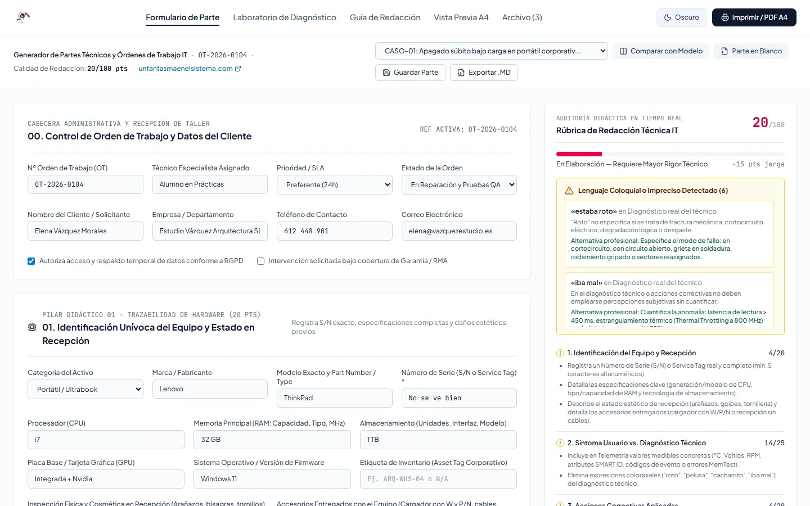
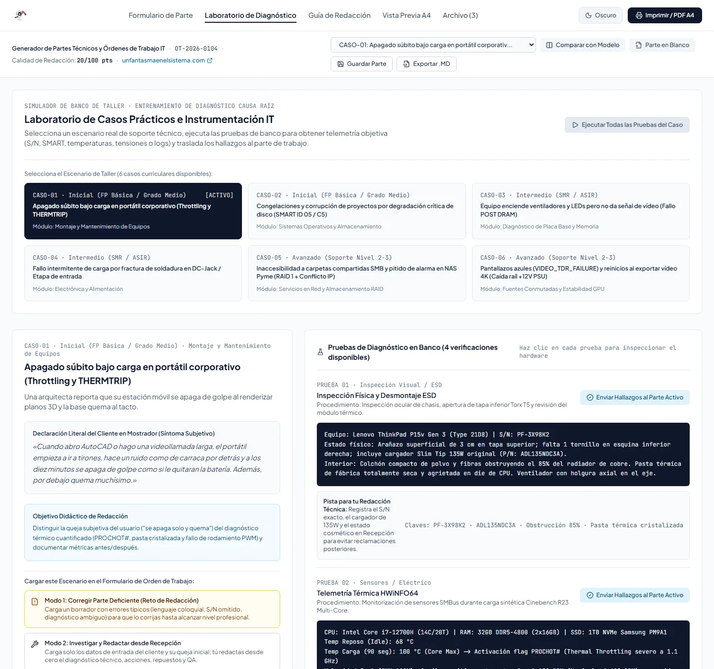
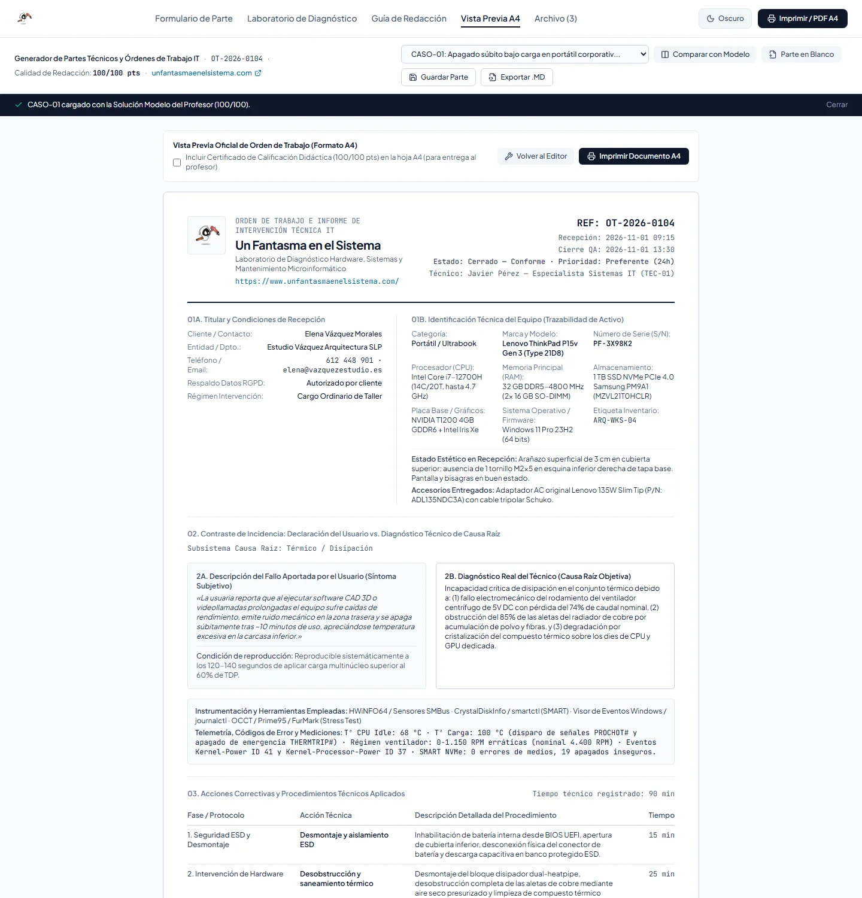
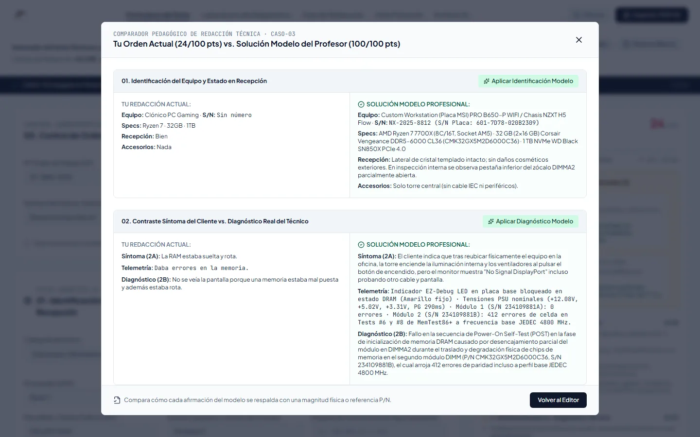

<p align="center">
  <a href="https://www.unfantasmaenelsistema.com"></a>
</p>

<h1 align="center">Generador de Partes Técnicos IT</h1>

<p align="center">
  <b>Redacta órdenes de trabajo de taller como un profesional y aprende a diferenciar lo que dice el cliente de lo que mide el técnico</b><br>
  Identificación del equipo · Síntoma frente a diagnóstico · Acciones correctivas · Piezas con P/N · Pruebas de conformidad · Documento A4 y Markdown
</p>

<p align="center">
  <a href="https://unfantasmaenelsistema.github.io/Generador-Partes-Tecnicos-IT/"><b>▶ Abrir el generador</b></a> ·
  <a href="#qué-hace">Qué hace</a> ·
  <a href="#para-clase">Para clase</a> ·
  <a href="#cómo-evalúa">Cómo evalúa</a> ·
  <a href="#desarrollo">Desarrollo</a> ·
  <a href="https://www.unfantasmaenelsistema.com">unfantasmaenelsistema.com</a> ·
  <a href="LICENSE">MIT</a>
</p>

<p align="center">
  
  
  
  
</p>

<p align="center">
  
</p>

Un parte técnico sirve de garantía, de factura y de historial del equipo, así que tiene que poder auditarse: número de serie real, diagnóstico con magnitudes, piezas con su referencia y pruebas finales con valores medidos. El generador lo enseña con seis averías reales de taller. El alumno parte de un borrador lleno de vaguedades («estaba roto», «le eché pasta», «todo ok»), investiga en un laboratorio simulado y reescribe el parte hasta que la rúbrica lo da por bueno.

> [!NOTE]
> Los casos, equipos y mediciones son verosímiles pero ficticios; los nombres de clientes son inventados. Todo se guarda en el propio navegador.

## Qué hace

- **Formulario completo de orden de trabajo**: cliente y autorizaciones (RGPD, garantía), identificación del equipo, síntoma del cliente y diagnóstico técnico, herramientas y telemetría, acciones por fases con tiempos, piezas sustituidas con P/N y garantía, pruebas de conformidad y notas finales.
- **Rúbrica en tiempo real (100 puntos)** en cinco pilares, con aviso de cada expresión coloquial y de lo que falta para llegar al nivel profesional.
- **Laboratorio de diagnóstico** por caso: inspección visual, HWiNFO64, SMART, MemTest86+, tester ATX, osciloscopio, visor de eventos o WinDbg, con su salida y una pista de interpretación. Los hallazgos se envían al parte y la herramienta queda registrada.
- **Guía de redacción** con verbos técnicos normalizados y ejemplos de cómo pasar del lenguaje del mostrador al del informe.
- **Comparación lado a lado** con la solución modelo del profesor y opción de aplicar una sección del modelo.
- **Documento A4** listo para imprimir o guardar como PDF (con o sin la calificación) y **exportación a Markdown**, con mano de obra, piezas, base imponible e IVA en formato español.
- **Archivo local** de partes con búsqueda, exportación e importación en JSON.

<p align="center">
  
</p>

## Para clase

| Caso | Avería | Lo que hay que demostrar |
| :-- | :-- | :-- |
| 01 | Portátil que se apaga bajo carga | Ventilador con rodamiento gripado y radiador obstruido: PROCHOT, THERMTRIP y eventos 41 y 37 |
| 02 | Workstation que se congela | Disco con sectores reasignados, pendientes e incorregibles (SMART 05, C5, C6) |
| 03 | Enciende pero no da imagen | LED DRAM de EZ-Debug, módulo desencajado y otro con errores en MemTest86+ |
| 04 | Carga intermitente | Soldadura fracturada en el DC-Jack, medida con polímetro y fuente de laboratorio |
| 05 | NAS inaccesible y pitando | Cambio de subred tras sustituir el router y RAID 1 degradado por un corte |
| 06 | Pantallazos azules al exportar vídeo | La GPU está sana: la fuente cae a 11,08 V con 165 mVpp de rizado |

Cada caso se puede abrir de tres maneras: **corregir el borrador deficiente**, **redactar desde la recepción** investigando en el laboratorio, o **examinar la solución modelo**. Las pruebas automáticas comprueban que los seis borradores suspenden y que las seis soluciones modelo sacan 100.

<p align="center">
  
</p>

## Cómo evalúa

| Pilar | Puntos | Qué mira |
| :-- | :-: | :-- |
| Identificación y recepción | 20 | Número de serie real, marca y modelo exactos, especificaciones con modelo y capacidad, estado estético y accesorios |
| Síntoma frente a diagnóstico | 25 | Síntoma del cliente con contexto, herramientas y telemetría con magnitudes o códigos, diagnóstico técnico distinto del síntoma y sin coloquialismos |
| Acciones correctivas | 20 | Al menos dos fases redactadas con terminología técnica |
| Piezas y trazabilidad | 15 | P/N o SKU y referencias retirada e instalada de cada pieza, o justificación de que no hizo falta recambio |
| Pruebas de conformidad | 20 | Al menos dos pruebas superadas con valores medidos; una orden cerrada como «Conforme» no puede tener pruebas sin superar |

Cada expresión coloquial en un campo técnico resta 3 puntos (hasta 15). El síntoma del cliente no se penaliza: es normal que el cliente hable con sus palabras.

<p align="center">
  
</p>

## Privacidad

Todo se ejecuta en el navegador, sin servidor ni cuentas. Los partes guardados están en el almacenamiento local del navegador y solo salen de él si los exportas. Las fuentes van incluidas en la web y una política CSP estricta impide cargar código o estilos de terceros.

## Desarrollo

Requisitos: Node.js 20 o superior.

```bash
git clone https://github.com/unfantasmaenelsistema/Generador-Partes-Tecnicos-IT.git
cd Generador-Partes-Tecnicos-IT
npm ci
npm run dev      # http://localhost:3000
npm test         # pruebas del evaluador y de los cálculos (Vitest)
npm run lint     # comprobación de tipos
npm run build    # versión estática en dist/
```

El workflow `.github/workflows/deploy.yml` comprueba tipos, pasa las pruebas, compila y publica `dist/` en GitHub Pages en cada push a `main`.

```text
src/
├── data/didacticCases.ts         # los 6 casos, catálogo de herramientas, verbos y reglas de lenguaje coloquial
├── utils/evaluateWorkOrder.ts    # rúbrica de 5 pilares
├── utils/workOrderTotals.ts      # importes, formato en euros y herramientas del laboratorio
├── utils/workOrderSchema.ts      # validación de partes importados
├── utils/exportMarkdown.ts
├── utils/workOrder.test.ts
└── components/                   # formulario, laboratorio, guía, documento A4, archivo y comparación
```

## Cambios

### 2.0.0 (2026-11-01)

- Publicado en la organización con despliegue en GitHub Pages y con el nombre corregido: GitHub había convertido la «é» de «Técnicos» en un guion (`Generador-Partes-T-cnicos-IT-`). Las URL antiguas redirigen al nuevo nombre. El workflow original no podía funcionar (`npm install` fallaba por un conflicto de versiones de `esbuild` y la caché de npm no tenía lockfile).
- **Datos técnicos de los casos**: el evento de Windows que avisa de que el firmware limita la CPU es el **ID 37** de Kernel-Processor-Power, no el 86; el caso 1 atribuía el apagado al «Thermal Throttling» cuando lo provoca THERMTRIP; el evento 153 lo registra el origen Disk, no storahci; el caso 3 citaba un código POST en una placa sin display de códigos, «errores ECC/de paridad» en memoria DDR5 sin ECC y una medida de rizado hecha con tester ATX (requiere osciloscopio).
- **Laboratorio**: enviar los hallazgos al parte no registraba la herramienta usada, y el alumno perdía puntos sin saber por qué.
- **Rúbrica**: un parte vacío sumaba 9 puntos; cerrar una orden como «Conforme» con pruebas sin superar no se penalizaba.
- **Robustez**: importar un JSON con una orden mal formada dejaba la app en blanco y, como ya estaba guardada en el navegador, seguía rota al recargar. Ahora se valida al importar y al cargar.
- **Importes** calculados en un único sitio, redondeados a céntimos y en formato español (1.234,50 €); el Markdown escapa las barras de las tablas.
- **Interfaz**: la cabecera desbordaba a 1.000 px y la página entera en el móvil.
- Fuentes incluidas en la web en lugar de Google Fonts, CSP estricta, fuera dependencias de Gemini y Express que no se usaban, licencia MIT y 14 pruebas automáticas.

### 1.0.0

- Versión inicial generada con Google AI Studio.

## Créditos y licencia

Creado por **[Un Fantasma en el Sistema](https://www.unfantasmaenelsistema.com)** para los módulos de montaje y mantenimiento de equipos de FP. Fuentes Plus Jakarta Sans y JetBrains Mono (SIL Open Font License) vía Fontsource; iconos de Lucide (ISC).

Código bajo licencia [MIT](LICENSE).
