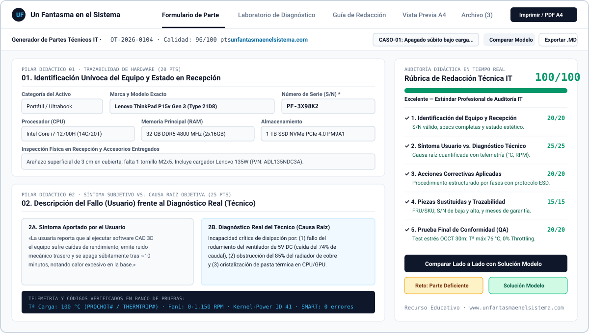
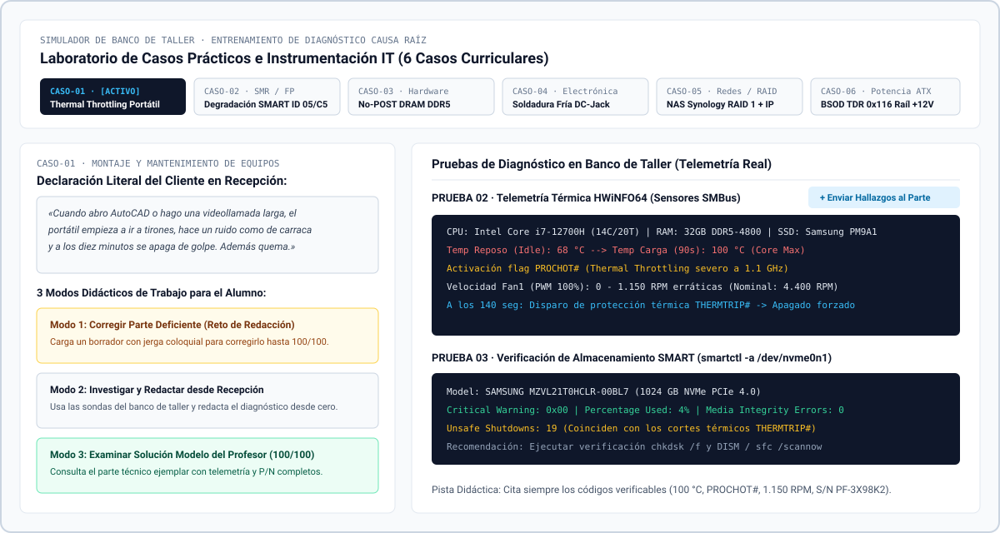
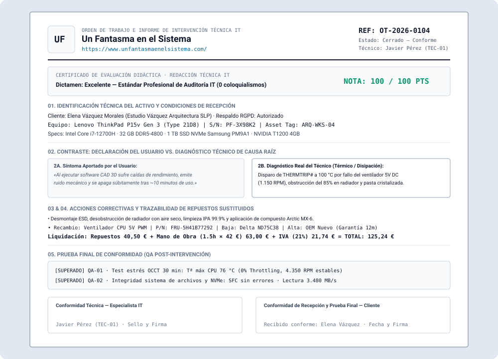

<div align="center">
  <a href="https://www.unfantasmaenelsistema.com/" target="_blank" rel="noopener noreferrer">
    
  </a>

  # Generador de Partes Técnicos y Órdenes de Trabajo IT

  **Entrenador didáctico de redacción técnica precisa, diagnóstico de causa raíz y documentación auditable para taller microinformático y Formación Profesional (SMR / ASIR / DAW / DAM).**

  Un proyecto educativo y profesional de **[Un Fantasma en el Sistema](https://www.unfantasmaenelsistema.com/)**

  [](https://www.unfantasmaenelsistema.com/)
  [](./LICENSE)
  [](./.github/workflows/deploy.yml)
</div>

---

## Qué hace esta aplicación

El **Generador de Partes Técnicos y Órdenes de Trabajo IT** es una aplicación web 100 % funcional en navegador (sin necesidad de backend ni bases de datos externas) diseñada tanto para el **entrenamiento didáctico en el aula de informática** como para la **generación real de partes de intervención técnica**.

Su objetivo pedagógico es enseñar a estudiantes y técnicos de soporte a redactar **documentación técnica precisa, objetiva y auditable**, erradicando el uso de argot o descripciones ambiguas (*«estaba roto»*, *«tenía pelusa»*, *«le eché pasta»*, *«le pasé un programa»*, *«todo ok»*) y estructurando cada intervención en **cinco pilares fundamentales**:

1. **Identificación Unívoca del Equipo y Recepción**: Categoría, marca, modelo exacto, número de serie (`S/N` o *Service Tag*), etiqueta de inventario, especificaciones completas (`CPU`, `RAM`, `Almacenamiento`, `Placa/GPU`, `SO`), estado estético previo y accesorios recepcionados (con `P/N`).
2. **Descripción del Fallo Aportada por el Usuario vs. Diagnóstico Real del Técnico**: Diferenciación rigurosa entre el síntoma subjetivo reportado por el cliente en mostrador y el dictamen técnico objetivo de causa raíz respaldado por instrumentación y telemetría (`°C`, `V`, `RPM`, atributos `SMART`, códigos `POST`, `Minidump BSOD`, `Event ID`).
3. **Acciones Correctivas Aplicadas**: Procedimiento técnico cronológico dividido por fases (*Seguridad ESD y Desmontaje*, *Intervención de Hardware*, *Firmware / Sistema*, *Saneamiento y Montaje*) con verbos técnicos normalizados y control de tiempos.
4. **Trazabilidad de Piezas Sustituidas y Liquidación Económica**: Registro de recambios con su *Part Number* (`P/N`, `FRU` o `SKU`), referencia/serie del componente retirado (baja) frente al instalado (alta), meses de garantía y cálculo automático de mano de obra, base imponible e IVA.
5. **Prueba Final de Conformidad (QA)**: Lista de verificación post-reparación que exige **métricas cuantitativas** verificadas antes del cierre y firma de la orden.

---

## Capturas de Pantalla

### 1. Editor de Orden de Trabajo y Rúbrica Didáctica en Tiempo Real (0–100 pts)
Evalúa al instante los 5 pilares del parte técnico, detecta expresiones coloquiales e indica qué criterios o magnitudes faltan para alcanzar el estándar de auditoría IT.



### 2. Laboratorio de Diagnóstico e Instrumentación de Taller
Permite inspeccionar la queja literal del cliente, ejecutar pruebas simuladas de banco (`HWiNFO64`, `smartctl`, `MemTest86+`, `WinDbg`, `Osciloscopio / Polímetro TrueRMS`) y enviar los hallazgos directamente al parte activo.



### 3. Hoja Oficial A4 Imprimible / PDF con Certificado de Calificación Didáctica
Genera un documento oficial A4 listo para imprimir o guardar como PDF (`Ctrl+P` / `Cmd+P`), con opción de incluir el **Certificado de Evaluación Didáctica** en la cabecera para entregas de prácticas al profesor.



---

## Casos Prácticos Incluidos y Modos de Entrenamiento

La aplicación incorpora **6 escenarios curriculares reales** listos para trabajar en **3 modos pedagógicos**:

- **Modo 1 — Reto: Corregir Parte Deficiente**: Carga un parte redactado por un técnico principiante lleno de vicios habituales (lenguaje coloquial, S/N omitido, diagnóstico confuso, cierre sin métricas) para que el alumno lo reescriba hasta superar los 85/100 puntos.
- **Modo 2 — Investigar y Redactar desde Recepción**: Carga únicamente los datos del cliente y su queja verbal; el alumno debe ejecutar las sondas en el *Laboratorio de Diagnóstico* y redactar desde cero el diagnóstico técnico, acciones, repuestos y pruebas QA.
- **Modo 3 — Examinar Solución Modelo del Profesor (100/100)**: Carga la resolución ejemplar completa o abre el **Comparador Lado a Lado** para contrastar cada sección del alumno frente a la solución modelo.

| Código | Escenario Técnico de Taller | Módulo / Área Curricular | Causa Raíz y Telemetría Clave |
| :--- | :--- | :--- | :--- |
| **CASO-01** | Apagado súbito bajo carga en portátil CAD | Montaje y Mantenimiento de Equipos | Disparo de `PROCHOT#` / `THERMTRIP#` (100 °C), ventilador a 1.150 RPM con holgura axial y radiador obstruido al 85 %. |
| **CASO-02** | Congelaciones al abrir carpetas en disco secundario | Sistemas Operativos y Almacenamiento | Degradación física en HDD (`SMART ID 05 = 184` reasignados, `ID C5 = 47` pendientes) y timeouts AHCI (`Event ID 129/153`). |
| **CASO-03** | Equipo enciende LEDs pero no da señal de vídeo | Diagnóstico de Placa Base y Memoria | Bloqueo `EZ-Debug DRAM` en POST por desencajamiento en `DIMMA2` y 412 errores de celda en `MemTest86+` a JEDEC 4800 MHz. |
| **CASO-04** | Carga intermitente al forzar cable y clavija caliente | Electrónica y Alimentación | Fractura anular de soldadura (soldadura fría) en pin positivo `+19V` del conector `DC-Jack` y calentamiento por efecto Joule (84 °C). |
| **CASO-05** | Carpetas SMB inaccesibles y alarma acústica en NAS | Servicios en Red y Almacenamiento RAID | Incidencia concurrente: conflicto de subred IPv4 tras cambio de router ISP + caída de Bahía 2 en matriz `RAID 1 Btrfs`. |
| **CASO-06** | Pantallazos azules (`0x116`) al exportar vídeo 4K | Fuentes Conmutadas y Estabilidad GPU | `VIDEO_TDR_FAILURE` originado por caída del raíl `+12V` a `11.08 V` (< `11.40 V` mín. ATX) y rizado de `165 mVpp` en fuente envejecida. |

---

## Rúbrica de Evaluación Automática (100 Puntos)

| Pilar Didáctico | Puntuación Máxima | Criterios Auditados en Tiempo Real |
| :--- | :---: | :--- |
| **1. Identificación del Equipo** | **20 pts** | `S/N` válido (no genérico), marca/modelo exactos, especificaciones detalladas (`CPU`, `RAM`, `Almacenamiento`), estado cosmético y accesorios. |
| **2. Síntoma vs. Diagnóstico** | **25 pts** | Separación entre síntoma del usuario y causa raíz técnica, selección de instrumentación e inclusión de magnitudes/códigos verificables. |
| **3. Acciones Correctivas** | **20 pts** | Desglose en múltiples etapas técnicas, uso de verbos de acción precisos y ausencia de expresiones domésticas. |
| **4. Piezas Sustituidas** | **15 pts** | Registro de `P/N / FRU / SKU`, referencia del componente retirado (baja) e instalado (alta), y periodo de garantía. |
| **5. Prueba Final de Conformidad** | **20 pts** | Pruebas superadas con resultados numéricos medibles (`°C`, `MB/s`, `V`, `0 errores`) en lugar de cierres genéricos. |
| **Penalización por Jerga** | **Hasta -15 pts** | Detección en vivo de coloquialismos (*«roto»*, *«pelusa»*, *«cacharrito»*, *«echar pasta»*, *«iba mal»*, *«todo ok»*). |

---

## Instalación y Uso Local

### Requisitos previos
- **Node.js** 18+ y **npm**

### Pasos
```bash
# 1. Clonar el repositorio
git clone https://github.com/tu-usuario/generador-partes-tecnicos-it.git
cd generador-partes-tecnicos-it

# 2. Instalar dependencias
npm install

# 3. Iniciar servidor de desarrollo (http://localhost:3000)
npm run dev

# 4. Generar compilación estática de producción en /dist
npm run build
```

---

## Despliegue en GitHub Pages

El proyecto está preconfigurado con `base: './'` en `vite.config.ts` y un flujo de trabajo automatizado en [`.github/workflows/deploy.yml`](./.github/workflows/deploy.yml):

1. Sube el código a tu repositorio en GitHub (rama `main` o `master`).
2. En tu repositorio de GitHub, ve a **Settings → Pages**.
3. En **Build and deployment → Source**, selecciona **GitHub Actions**.
4. Con cada `git push`, GitHub Actions compilará automáticamente la aplicación y la publicará en tu URL de GitHub Pages.

---

## Créditos y Autoría

Desarrollado como recurso educativo abierto para estudiantes y profesionales de Sistemas Microinformáticos y Redes:

- **Proyecto y Web Oficial:** [Un Fantasma en el Sistema — https://www.unfantasmaenelsistema.com/](https://www.unfantasmaenelsistema.com/)
